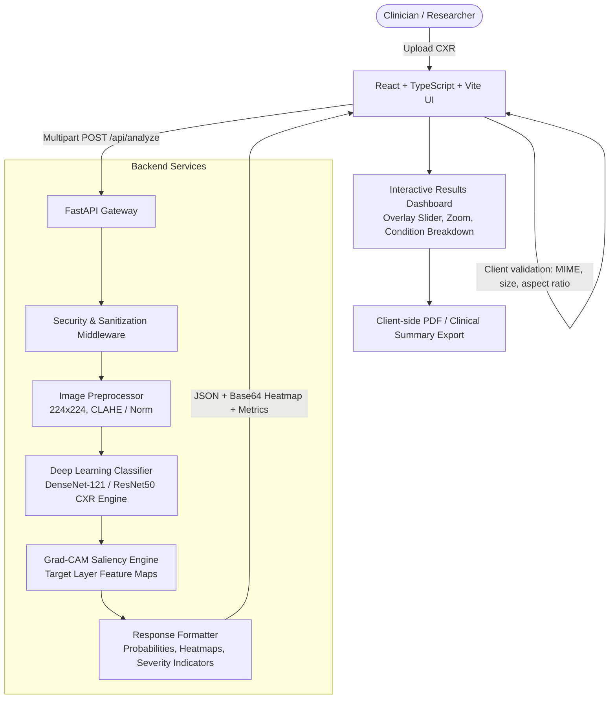

# System Architecture: Explainable Real-Time Chest X-Ray Disease Detection

## 1. Executive Summary & Objective
This system provides an end-to-end, privacy-conscious, explainable AI research platform for screening chest X-ray radiographs. 
The system accepts standard frontal chest radiographs (CXR, DICOM/PNG/JPEG), preprocesses the image to standardized clinical input dimensions, performs multi-label disease probability estimation across key thoracic pathologies (e.g., Cardiomegaly, Pneumonia, Effusion, Infiltration, Atelectasis, Pneumothorax, Nodule, Mass, Consolidation, Normal), generates visual saliency explanations via Gradient-weighted Class Activation Mapping (Grad-CAM), and formats interactive diagnostic reports with prominent medical disclaimers.

---

## 2. Medical Safety & Ethical Boundaries
> [!IMPORTANT]
> **MANDATORY DISCLAIMER:**
> *"AI-assisted screening/research prototype. Not a substitute for professional medical diagnosis."*
>
> 1. All classifications are probabilistic likelihoods. Benchmark figures cited in this project (e.g., AUROC values) are published values from external research literature (NIH ChestX-ray14, CheXpert) and do NOT represent measured performance of this project's demo model.
> 2. The system does not write or persist patient protected health information (PHI) to external logs or persistent databases without explicit user consent.
> 3. Grad-CAM visual heatmaps highlight regions of interest influencing model feature activation, which must be interpreted exclusively by licensed clinicians.

---

## 3. High-Level System Architecture

---

## 4. Subsystem Breakdown & Agent Ownership

### A. Frontend (`frontend/`) - React + TypeScript + Vite + Tailwind CSS
- **Dropzone & Upload Station**: Drag-and-drop CXR upload with instant client-side preview, validation, and sample library.
- **Explainability Viewer**: Side-by-side and overlay view with an opacity slider allowing dynamic blending between the original X-ray and the Grad-CAM heatmap.
- **Pathology Indicator Cards**: Color-coded probability distributions with calibrated thresholds (Low, Moderate, High risk indicators).
- **Report Generator**: Clean, print-friendly clinical summary export with timestamp, image hash, model version, and prominent disclaimers.
- **Design System**: High-contrast, clean medical UI adhering to accessibility (WCAG AA) standards.

### B. Backend (`backend/`) - Python + FastAPI
- **FastAPI Core**: Lightweight asynchronous API server (`/api/health`, `/api/analyze`, `/api/conditions`, `/api/sample-images`).
- **Image Pipeline**: Validates image format/magic bytes, resizes to target resolution (224x224), normalizes using ImageNet/CXR statistics.
- **Model Engine**: Multi-label classifier outputting calibrated probabilities across thoracic conditions. Supports benchmark weights (DenseNet-121 architecture trained on CXR dataset representations) with graceful synthetic fallback for offline/low-resource modes.
- **Grad-CAM Explainer**: Computes gradients of the target class score with respect to the final convolutional feature maps, generates normalized 2D heatmaps, applies Jet/Turbocolor colormaps, and outputs composite overlays.

### C. Database (`database/`) - Standby / Deferred
- **Decision**: Deferred for MVP. Analysis is stateless. Images are processed in memory and immediately discarded. Eliminates storage costs, reduces data-at-rest risk, and removes database setup complexity. This project has not been formally evaluated for regulatory compliance.

### D. Security Architecture
- Maximum payload limit: 10MB.
- Allowed types: image/png, image/jpeg, image/webp (DICOM handled via client or server converter).
- Magic byte validation before decoding to prevent polyglot file attacks.
- Ephemeral in-memory processing: zero disk retention of sensitive user uploads by default.
- Rate limiting and standard CORS restrictions.

### E. QA Framework
- Backend unit tests (`pytest`) covering: API endpoints, image sanitization, tensor transformation, Grad-CAM dimension integrity.
- Frontend linting, type-checking (`tsc`), and component testing.
