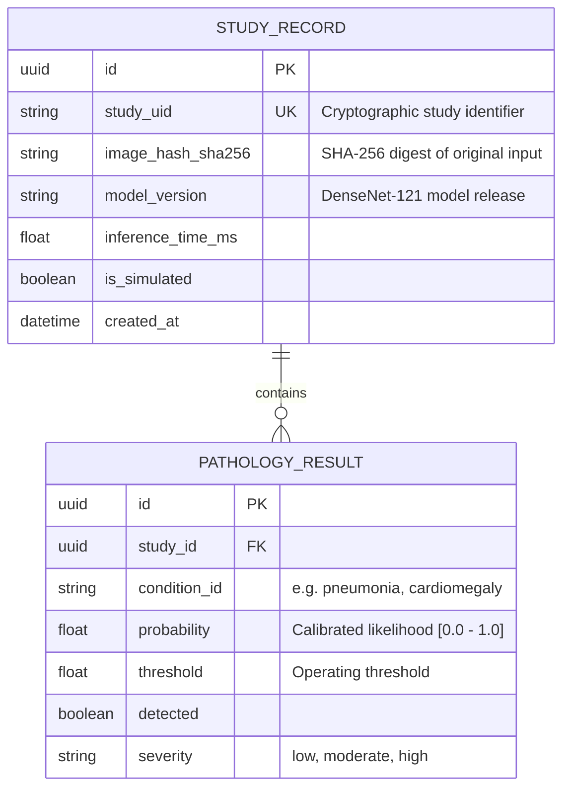

# Database Architecture Assessment & Data Minimization Strategy

**Role:** Database Architect  
**Project:** Explainable Real-Time Chest X-Ray Disease Detection  
**Document Status:** Official Architecture Assessment (MVP)  
**Date:** 2026-09-29  

---

## 1. Executive Determination: Is a Database Required for the MVP?

> [!IMPORTANT]
> **VERDICT: NO DATABASE REQUIRED FOR CURRENT MVP.**
>
> In accordance with our core architectural principles, **ADR-001**, and data minimization guidelines, the system operates as a **purely stateless, ephemeral image processing pipeline**.

### Rationale:
1. **Core User Story:** A clinician or researcher uploads a chest radiograph, views real-time multi-label predictions and Grad-CAM saliency heatmaps, inspects pathology definitions, and optionally prints/downloads a consultation summary.
2. **Zero Inherent Need for State:** All operations execute in-memory in under 500ms. The response payload returns all required data directly to the client session.
3. **Privacy by Design (Data Minimization):** Chest radiographs are sensitive medical data. Not storing patient images or identifiers eliminates the primary vector for data leakage and unauthorized access. This project has not been formally evaluated for HIPAA or GDPR compliance.
4. **Operational Simplicity:** Eliminating database servers, connection pools, and migration locks removes points of failure and operational complexity during rapid iteration.

---

## 2. Six-Question Schema & Necessity Review

Before considering any table or persistent schema, we evaluate the six mandatory criteria:

| Evaluation Question | Assessment for Current MVP |
|---|---|
| **1. Why would this table exist?** | An "analyses" or "images" table would exist only if users needed historical session retrieval across browser restarts. |
| **2. What requirement does it satisfy?** | No current requirement requests cross-device synchronization, user accounts, or historical cohort queries. |
| **3. Can existing mechanisms satisfy this?** | **Yes.** In-memory request lifecycles and client-side print-to-PDF / JSON export fully satisfy all current reporting needs. |
| **4. Is the data actually required?** | No. Once the radiologist reviews the real-time inference and exports the report, the transient image buffer is discarded. |
| **5. How long should the data exist?** | Transiently: only for the duration of the HTTP request lifecycle (~150–500 ms). |
| **6. Is sensitive data being retained?** | Under the current stateless design: **Zero sensitive data is retained on disk or database.** |

---

## 3. Data Minimization Protocol

If and when persistence requirements are approved by the Lead Orchestrator, the following **Data Minimization Rules** must be strictly enforced:

1. **Never Store Raw Patient X-Rays in a Database:**
   - Raw binary blobs (`BYTEA`, `BLOB`) must never be written to database rows.
   - If image persistence is ever required, store only a cryptographically hashed reference (`image_hash_sha256`) and ephemeral encrypted object storage keys with strict TTLs (e.g., 24-hour auto-expunge).
2. **De-Identification & Pseudonymization:**
   - Patient names and identifying numbers must never enter database columns in plaintext. Use client-side pseudonyms (e.g., `PT-XXXX`) or salted cryptographic hashes.
3. **Audit Log Segregation:**
   - Operational telemetry (inference latency, model version, detected class distribution) must be decoupled from patient identifiers.

---

## 4. Blueprint for Future Persistence (When Requirements Justify It)

When multi-user authentication, cohort research, or regulatory compliance auditing are formally requested, the database stack should evolve as follows:

- **Local Development / Embedded Testing:** SQLite (`ai_screening.db` with WAL mode)
- **Production / Scaled Deployment:** PostgreSQL with SQLAlchemy / SQLModel / Alembic

### Future Schema Blueprint (Minimalist 3NF Design):

### Performance & Security Constraints for Future Schemas:
- **No N+1 queries:** All study-to-prediction queries must use eager joins (`joinedload` / `selectinload`).
- **Targeted Indexes Only:** Index on `study_uid` (unique) and `(condition_id, detected)` for population-level queries. No blind indexing on non-queried columns.
- **Parameterized Queries:** Exclusively use modern ORM parameterization or prepared statements; zero raw SQL string concatenation.

---

## 5. Conclusion & Action Items

- **Database Directory:** `database/` remains intentionally clean and decoupled from runtime dependencies.
- **No Action Needed for Backend:** Backend does not need to install SQLAlchemy, psycopg2, or SQLite drivers for the MVP.
- **Review Status:** Ready for QA and Security Agent sign-off.
